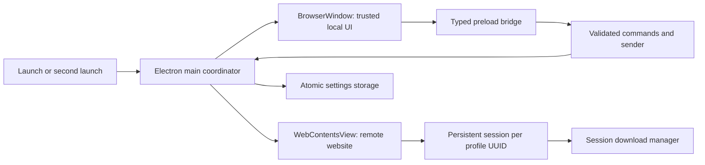

# Architecture

## Trust boundaries

The local React UI is served from `dock://ui` in packaged/production builds. Its narrow preload exposes command invocation and state subscription only. IPC accepts the registered shell window's main frame, validates its URL, and parses the payload with a discriminated Zod schema. The remote view receives no preload bridge.

In development, Vite serves the local shell and the sender is checked against that configured origin. The remote site remains a separate sandboxed WebContentsView. Local CSP disallows frames and objects. Remote navigation and popup creation use exact URL host/protocol policies.

## Sessions and windows

Profile UUIDs select `persist:profile-<uuid>` partitions. Display names never determine paths or partition identity. Session configuration and download listeners are registered once per session. A profile switch replaces the remote view. Active downloads block profile switching. Active windows, authentication windows, or downloads block deletion. Profile deletion revalidates after confirmation before clearing session storage.

Second process launches hand off to the existing coordinator. Windows hold their own remote views and history. When a window closes without downloads, its remote WebContents closes explicitly. A view with downloads is retained until completion and then closed. macOS keeps the app available after the last window closes; activation creates a window. On Windows the app quits when no windows or transfers remain.

Settings writes are debounced, serialized, and atomically renamed. A corrupt settings file is preserved with a recovery filename; browser profile directories are not deleted. Saved website locations omit query strings/fragments and must pass the content URL policy before restoration.

## Downloads

The session's `will-download` event controls the original browser download, preserving authentication and blob handling. Native save dialogs handle user-selected overwrite confirmation. Automatic saves use sanitized filenames with random UUID qualifiers, avoiding same-name collisions from application downloads. No remote download URL is persisted.

Finished metadata is bounded and written asynchronously. On startup, unfinished metadata is treated as interrupted and not resumable. Closing a window and quitting the application are distinct operations. The latter asks before canceling active transfers.

## Performance

Local UI state updates are coalesced. An isolated, read-only typography observer samples computed font size from a fixed set of message/composer selectors. It coalesces DOM/style/resize events, reports only changed numeric font sizes, and never reads conversation text or rewrites website styles. There is no periodic page polling. Toolbar sizing accounts for website zoom and adjusts the native view bounds. Observers are disposed on profile switches and window closure. Hardware acceleration is left enabled. Diagnostics sample Electron process metrics only on demand. Browser and utility processes may serve multiple windows. Process working sets may include shared pages; summing them is not a measurement of exclusive physical memory.

The integration fixture tests rendering, resource lifecycle, uploads, downloads, and sessions without needing a real account. It does not replace website-specific manual verification.
